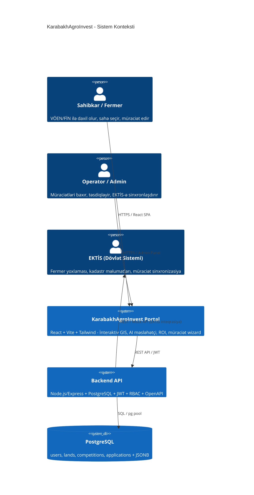
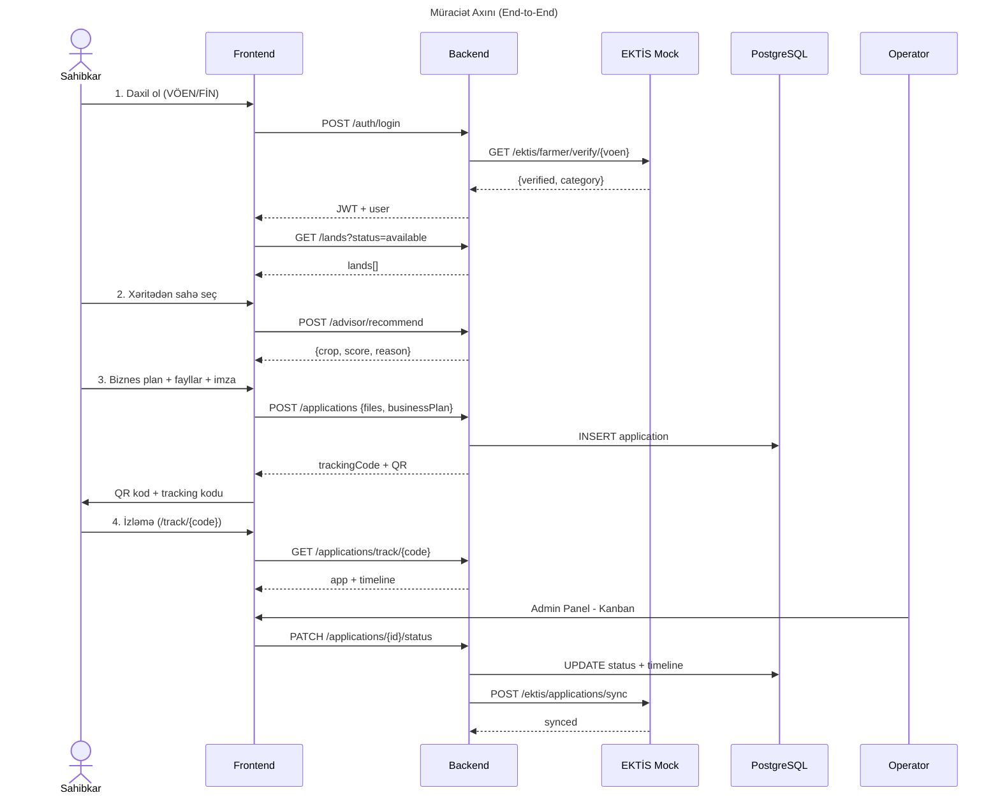

# KarabakhAgroInvest

> **Qarabağın bərpasında aqrar innovasiya və şəffaf investisiya.**
> İşğaldan azad edilmiş ərazilər üçün investisiya müsabiqəsi portalı — hackathon prototipi.

İnteraktiv GIS xəritəsindən torpaq seçimi → AI tövsiyəsi + NDVI peyk monitorinqi → Agro-ROI simulyasiyası →
4 addımlı müraciət wizard-u → QR kodla şəffaf izləmə → Kanban təsdiqi → EKTİS ilə sinxronizasiya →
analitika dashboard-u. **Tam işlək end-to-end axın.**

---

## Nə var? (Killer Features)

| Modul | Təsvir |
| --- | --- |
| 🗺️ **İnteraktiv GIS xəritə** | Rayon və təyinat üzrə rəngli zonalar (Leaflet + OpenStreetMap). Sahə seçiləndə pH, münbitlik indeksi, su mənbəyinə məsafə, günəşli günlər göstərilir. |
| 🛰️ **NDVI peyk qatı** | Xəritədə bitki örtüyü (NDVI) istilik xəritəsi qatı + seçilmiş sahə üçün 12 aylıq vegetasiya qrafiki (Sentinel-2 mock). |
| 🤖 **Ağıllı Məsləhətçi (AI)** | Sahənin aqronomik profilinə (pH, münbitlik, su, günəş, bazar) görə məhsulları 0–100 bal ilə qiymətləndirir, radar qrafiki və tövsiyə verir. |
| 📈 **Agro-ROI kalkulyatoru** | Məhsul + hektar → ilkin investisiya, illik gəlir/xalis mənfəət, özünüödəmə müddəti, 5 illik ROI. |
| 🧭 **Smart Application Wizard** | 1) VÖEN/FİN profil təsdiqi (EKTİS) 2) Xəritədən sahə seçimi 3) Biznes plan + AI tövsiyəsi + fayllar 4) Rəqəmsal imza. |
| 🔐 **QR + İzləmə + E-qəbz** | Hər müraciətə `KAI-YYYY-XXXXX` kodu və QR verilir; status izlənir, **çap/PDF qəbz** generasiya olunur. |
| 🗂️ **Kanban iş axını** | Operator/admin müraciətləri sürüşdürmə (drag & drop) ilə mərhələlər arası köçürür. Axın: **Qəbul edilib → Baxılır → Əlavə məlumat tələb olunur → Qərar verilib (Təsdiq/İmtina)**. |
| 🏆 **Müsabiqə modulu** | Aktiv/gələcək investisiya müsabiqələri: büdcə, güzəştlər, iştirak şərtləri, mərhələlər, canlı geri sayım. **Admin panelindən yaratma/redaktə**, operator/admin üçün təsdiq mexanizmi (Yaxınlaşır/Aktiv/Bağlı). |
| 💼 **İş elanları lövhəsi** | Sahibkar/investor vəzifə, əmək haqqı, rayon və əlaqə ilə iş elanı yerləşdirir; **sadə istifadəçilər** elanları filtrələyib müraciət edir. Sahib elanı bağlaya/aça və müraciətçi siyahısını görə bilər. |
| 🔔 **Bildirişlər** | Yeni müraciət daxil olduqda operator/admin-lərə, status dəyişdikdə ərizəçiyə avtomatik bildiriş; navbar-da zəng ikonu, oxundu/oxunmadı sayğacı. |
| 🛠️ **Admin idarəetmə** | İstifadəçi təsdiqi, torpaq sahələrinin əlavəsi **və redaktəsi**, müraciət statuslarının idarəsi. |
| 📊 **Analitika dashboard** | Rayon/məhsul bölgüsü, müraciət funnel-i, investisiya potensialı, top müraciətlər (recharts). |
| 🏛️ **EKTİS inteqrasiyası (mock)** | Kadastr məlumatı, VÖEN fermer yoxlaması, müraciət sinxronizasiyası — REST API. |
| 🛡️ **JWT + RBAC** | 3 rol: `applicant`, `operator`, `admin`. Rol əsaslı giriş nəzarəti. Hesab növləri: **sahibkar / investor / sadə istifadəçi** (sadə istifadəçi dərhal aktiv — yalnız elanlara baxış və müraciət). |
| 📚 **OpenAPI / Swagger UI** | `/api-docs` ünvanında canlı, sınaqdan keçirilə bilən API interfeysi. |

---

## Texnoloji stek

- **Frontend:** React 18 · Vite · Tailwind CSS · Leaflet / react-leaflet · qrcode.react · recharts
- **Backend:** Node.js · Express · REST · JWT (`jsonwebtoken`)
- **Xəritə / data:** GeoJSON poliqonları, OpenStreetMap tiles
- **API sənədləşdirmə:** OpenAPI 3.0 + `swagger-ui-express`
- **Data:** PostgreSQL 18 + `pg` (connection pool) — `users`, `lands`, `competitions`, `applications`; strukturlaşmamış sahələr (geometry, ROI, skor, timeline) **JSONB**

---

## Quraşdırma və işə salma

```bash
# 1) asılılıqları yüklə
npm run install:all        # server + client

# 2) development rejimində (iki proses birlikdə: API :4000, Vite :5173)
npm run dev
```

Sonra brauzerdə aç: **http://localhost:5173**

### İstehsalat rejimi (tək servis)

```bash
npm run build              # client -> client/dist
npm start                  # server client-i özü təqdim edir
```

Bu halda hər şey **http://localhost:4000** ünvanından işləyir.
Swagger UI: **http://localhost:4000/api-docs**

---

## Verilənlər bazası (PostgreSQL)

Portal **real PostgreSQL** bazası ilə işləyir (keçici yaddaş deyil) — bütün verilər proses yenidən başladıqda da qalır.

```bash
cd server
cp .env.example .env          # sonra dəyərləri doldur
npm run db:init               # sxem (schema.sql) + ilkin məlumatlar (seed)
npm run db:reset              # cədvəlləri təmizlə + yenidən seed et
```

`.env` (nümunə):

```
PGHOST=localhost
PGPORT=5432
PGUSER=postgres
PGPASSWORD=your_password
PGDATABASE=karabakh
PORT=4000
JWT_SECRET=change_me
```

Cədvəllər (`server/src/db/schema.sql`): `users`, `lands`, `competitions`, `applications`, `vacancies`, `vacancy_applications`, `notifications`.
Strukturlaşmamış sahələr (geometry, ROI, skor, timeline, files) **JSONB** kimi saxlanılır.
Server hər qalxışda sxemi yoxlayır və baza boşdursa avtomatik seed edir; qoşulma alınmasa aydın xəta ilə dayanır.

---

## Demo hesablar

| Rol | VÖEN / FİN | Şifrə |
| --- | --- | --- |
| Sahibkar / İnvestor | `1234567890` | `demo123` |
| Sahibkar / İnvestor | `9988776655` | `demo123` |
| Nazirlik Operatoru | `ADMIN00000` | `admin123` |
| Sistem Administratoru | `SYSADMIN000` | `root123` |

Login səhifəsində hesablar üzərinə klikləyərək avtomatik doldura bilərsiniz. **Sadə istifadəçi** (`/register` → "Sadə istifadəçi") qeydiyyatdan keçən kimi dərhal aktiv olur və birbaşa iş elanları lövhəsinə yönləndirilir.

---

## Münsiflər üçün 2 dəqiqəlik demo ssenarisi

1. **Landing** (`/`) — müsabiqə banneri + geri sayım; killer feature kartları.
2. **Xəritə** (`/map`) — Füzuli rayonunu filtrələ, 50 ha pambıq sahəsini seç. `🛰️ NDVI qatı` düyməsini bas → bitki örtüyü xəritəsi. Sağ paneldə **AI Məsləhətçi** (radar + tövsiyə) və **NDVI qrafiki** görünür.
3. **Müsabiqə** (`/competition`) — büdcə, güzəştlər, iştirak şərtləri və mərhələlər; son tarix geri sayımı.
4. **Müraciət** (`/apply`) — `1234567890 / demo123` ilə daxil ol → EKTİS təsdiqi → sahə seç → AI tövsiyəsini tətbiq et → biznes plan → rəqəmsal imza → **göndər**.
5. **QR + İzləmə + Qəbz** — kod və QR anında yaranır. `/track/{kod}` səhifəsində **🧾 Qəbz / PDF** düyməsi ilə çap oluna bilən qəbz.
6. **Kanban** (`/admin` → "Kanban lövhəsi") — `ADMIN00000 / admin123` ilə gir → kartı **sürüşdür** və ya düymə ilə "Qəbul edilib → Baxılır → Qərar verilib" et → **EKTİS-ə sinxronlaşdır**.
7. **Müsabiqə idarəsi** (`/admin` → "Müsabiqələr") — `SYSADMIN000 / root123` (admin) ilə yeni müsabiqə **yarat/redaktə et**; operator/admin "Aktiv et / Bağla" ilə təsdiq et. Torpaqlar tabında sahəni **redaktə et**.
8. **İş elanları** (`/vacancies`) — `1234567890 / demo123` (sahibkar) ilə **yeni elan yerləşdir** (vəzifə, əmək haqqı, rayon); elanı aç/bağla və müraciətçiləri gör. Sonra `/register` → "Sadə istifadəçi" ilə qeydiyyatdan keç → birbaşa lövhəyə düşür → elana **müraciət et**.
9. **Analitika** (`/analytics`) — rayon/məhsul bölgüsü, funnel, investisiya potensialı, top müraciətlər.
10. **EKTİS & API** (`/integration`) — canlı inteqrasiya statusu, RBAC cədvəli və **Swagger UI**.

> **Bildirişlər:** istənilən hesabla daxil olanda navbar-da 🔔 ikonu; yeni müraciətdə operator/admin-lərə, status dəyişdikdə ərizəçiyə bildiriş düşür.

> **Qızıl qayda:** bir end-to-end ssenarini sıfır xəta ilə işlək göstər.

---

## REST API (əsas endpoint-lər)

```
POST   /api/v1/auth/login                    VÖEN/FİN → JWT
GET    /api/v1/lands                         Torpaq sahələri (filtr: district/purpose/status)
PUT    /api/v1/lands/{id}                    Torpaq sahəsini redaktə et (admin)
GET    /api/v1/lands/meta                    Rayonlar, təyinatlar, statuslar
GET    /api/v1/lands/stats                   Statistika
POST   /api/v1/roi/simulate                  Agro-ROI hesablanması
POST   /api/v1/applications                  Yeni müraciət → tracking kod + skor
GET    /api/v1/applications                  Siyahı (rola görə)
GET    /api/v1/applications/track/{code}     İctimai izləmə
PATCH  /api/v1/applications/{id}/status      Status dəyişmə (operator/admin)

# Müsabiqə, AI məsləhətçi, analitika
GET    /api/v1/competitions                  Müsabiqələr siyahısı
POST   /api/v1/competitions                  Yeni müsabiqə yarat (admin)
PUT    /api/v1/competitions/{id}             Müsabiqəni yenilə (admin)
PATCH  /api/v1/competitions/{id}/status      Status dəyişmə / təsdiq (operator/admin)
GET    /api/v1/competitions/active           Aktiv müsabiqə
POST   /api/v1/advisor/recommend             Sahə üzrə məhsul tövsiyəsi (AI)
GET    /api/v1/analytics/overview            Portal KPI + bölgü + funnel

# İş elanları (vakansiyalar)
GET    /api/v1/vacancies                     Açıq elanlar (filtr: q, district, employmentType)
GET    /api/v1/vacancies/mine                İstifadəçinin öz elanları (sahibkar/investor)
GET    /api/v1/vacancies/my-applications     İstifadəçinin müraciətləri
POST   /api/v1/vacancies                     Yeni iş elanı (sahibkar/investor/admin)
PUT    /api/v1/vacancies/{id}                Elanı yenilə (sahib)
PATCH  /api/v1/vacancies/{id}/status         Elanı aç/bağla (sahib)
GET    /api/v1/vacancies/{id}                Elan detalları
POST   /api/v1/vacancies/{id}/apply          Elana müraciət (giriş etmiş istənilən istifadəçi)

# Bildirişlər
GET    /api/v1/notifications                 İstifadəçinin bildirişləri ({ unread, items })
PATCH  /api/v1/notifications/{id}/read       Bildirişi oxundu kimi işarələ
POST   /api/v1/notifications/read-all        Bütün bildirişləri oxundu kimi işarələ

# EKTİS inteqrasiya (mock)
GET    /api/v1/ektis/lands                   Kadastr məlumatlarının çəkilməsi
GET    /api/v1/ektis/farmer/verify/{voen}    Fermer statusunun yoxlanması
POST   /api/v1/ektis/applications/sync       Müraciətin sinxronizasiyası
GET    /api/v1/ektis/status                  İnteqrasiya statusu
GET    /api/v1/ektis/ndvi/{landId}           Peyk NDVI seriyası (12 ay)
```

Tam interaktiv sənəd: **`/api-docs`** (Swagger UI) və **`/api-docs.json`** (xam OpenAPI).

---

## Layihə strukturu

```
karabakh-agro-invest/
├── server/                       # Express API
│   ├── src/
│   │   ├── index.js              # Server, route-lar, Swagger, statik client
│   │   ├── openapi.js            # OpenAPI 3.0 spesifikasiyası
│   │   ├── data/
│   │   │   ├── seed.js           # Rayonlar, məhsullar, torpaqlar, istifadəçilər, müsabiqələr
│   │   │   ├── constants.js      # Status mərhələləri (APPLICATION_STAGES, NEXT_ACTIONS)
│   │   │   └── store.js          # Data qatı (repository re-export)
│   │   ├── db/
│   │   │   ├── pool.js           # pg connection pool (env-dən)
│   │   │   ├── schema.sql        # Cədvəllər + indekslər (idempotent)
│   │   │   ├── repository.js     # Async CRUD (users/lands/competitions/applications)
│   │   │   ├── init.js           # Sxem + seed bootstrap
│   │   │   └── init-cli.js       # npm run db:init / db:reset
│   │   ├── middleware/auth.js    # JWT + RBAC
│   │   ├── routes/               # auth, lands, applications, roi, ektis, competitions, advisor, analytics
│   │   └── utils/                # roi.js, advisor.js (AI), score.js (skor + NDVI)
│   ├── smoke.ps1                 # End-to-end API smoke testi (15)
│   └── smoke2.ps1                # Müsabiqə/AI/analitika/NDVI testi (8)
└── client/                       # React + Vite
    └── src/
        ├── api.js                # API klient (fetch + JWT)
        ├── session.jsx           # Auth context
        ├── components/           # Navbar, MapView, ROICalculator, StageTracker, AdvisorPanel,
        │                         # NdviPanel, Countdown, StatCard, ScoreBadge, Receipt, Footer
        └── pages/                # Landing, MapPage, ApplyWizard, Track, AdminDashboard,
                                  # Analytics, Competition, Vacancies, Login, Register, Integration
```

---

## Yoxlama (smoke test)

```bash
cd server
powershell -ExecutionPolicy Bypass -File .\smoke.ps1     # 15 yoxlama
powershell -ExecutionPolicy Bypass -File .\smoke2.ps1    # 8 yoxlama
```

`smoke.ps1` (15): health, meta, lands, stats, ROI, EKTİS yoxlama, login, müraciət yaratma, ictimai izləmə,
EKTİS sinx, RBAC 403, operator təsdiqi, EKTİS lands, OpenAPI, Swagger UI.

`smoke2.ps1` (8): müsabiqə siyahısı, aktiv müsabiqə, AI tövsiyə, analitika KPI, funnel, NDVI seriyası,
müraciət skoru, müsabiqə əlaqəsi.

Node əsaslı API smoke testləri (müvəqqəti qovluqda): `kai_test.mjs` (29 yoxlama — əsas axın),
`kai_project_test.mjs` (25 — layihə atributları/metrikalar), `kai_vacancy_test.mjs` (27 — iş elanları
lövhəsi: elan yaratma, filtr, müraciət, sahib siyahısı, RBAC, sadə istifadəçi bloklanması).

---

## Arxitektura Diaqramı (Mermaid C4 Model)



```mermaid
C4Container
    title KarabakhAgroInvest - Konteyner Diaqramı

    Container(spa, "Frontend (React + Vite)", "TypeScript, React 18, Tailwind, Leaflet", "İstifadəçi interfeysi, xəritə, wizard, dashboard")
    Container(api, "Backend API", "Node.js/Express, JWT, OpenAPI", "REST API, auth, business logic, file upload")
    ContainerDb(db, "PostgreSQL", "PostgreSQL 18 + pg", "users, lands, competitions, applications (JSONB)")
    ContainerExt(ektis, "EKTİS Mock", "REST API", "Fermer yoxlaması, kadastr, sinxronizasiya")

    Rel(spa, api, "HTTPS/JSON", "REST API çağırır")
    Rel(api, db, "pg pool", "SQL sorğuları")
    Rel(api, ektis, "HTTPS/JSON", "EKTİS inteqrasiya")
```



---

## Gələcək yol xəritəsi (Roadmap)

- ✅ AI ilə məhsul tövsiyəsi və skorlaşdırma (`advisor.js`)
- ✅ Peyk NDVI monitorinqi (Sentinel-2 mock, 12 aylıq seriya)
- ✅ Analitika dashboard-u, müsabiqə modulu, Kanban iş axını, çap/PDF qəbz
- 🚧 Real Sentinel / Copernicus kəsilmiş təsvirləri və bulud (cloud) maskası
- ✅ Real PostgreSQL (pg + JSONB): users/lands/competitions/applications
- 🚧 PostGIS (real spatial data) və EKTİS real API-ləri
- 🚧 Sənədlərin elektron imza (ASAN İmza / E-imza) ilə təsdiqi
- 🚧 Excel/PDF ixracı və Dövlət üçün genişləndirilmiş statistika
